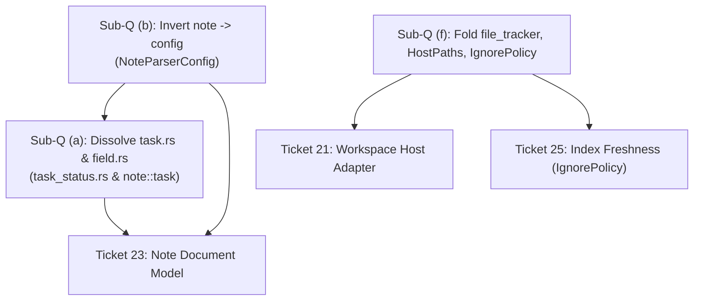

# Design Options: Config Ownership, Type Placement, and Ambient Seams (Ticket 22)

- **Deliverable Path**: `.scratch/arch-design/research/22-prep/e-design-type-placement.md`
- **Focus Sub-questions**:
  - **(a)** Root domain type placement (`task.rs`, `tag.rs`, `field.rs`, `TaskStatusMap`, tag filters, emoji/date parsing, `Tag`, and the disjoint `field.rs` hierarchies).
  - **(b)** Upward `note -> config` edge (`src/note/parser/input.rs:9`), parser inputs, and the `NoteParserConfig` pattern.
  - **(f)** Location of ambient primitives (`file_tracker.rs`, `dirs.rs`, `env_vars.rs`), OS snapshots, and directory ignore policy.
- **Baseline Git HEAD**: `8064cf76` (94,829 LoC across 72 source files, 25 crate-root modules).
- **Discipline & Rules**: `rust-design` discipline (concrete types first, invalid states unconstructable, typestate only for correctness-critical transitions, panic-free `Result` seams, no junk-drawer modules). Ticket 16 Visibility Rule (reduce visibility wherever possible, default direction is narrower). Ticket 21 Invariants (adapter snapshots OS inputs once at workspace open, independent per-workspace policy generations, zero process globals, Clippy `disallowed-methods`).
- **Claim Tags**: `[V]` verified by direct source read or compile; `[H]` inference; `[P]` proposal.

---

## 0. Executive Summary & Problem Decomposition

The root of `traces` (`src/`) currently holds 18 single-file modules alongside 7 multi-file subsystem directories [V: `src/lib.rs:110-134`]. Many of these root files were placed there historically to circumvent Rust's module cycle detector:

1. `src/task.rs` (1,911 LoC) hosts both task configuration models (`TaskStatusMap`, `TaskStatus`) and markdown document AST types (`TaskDateSet`, `TaskPriority`, emoji tables) solely so `config` and `note` could share task status symbols without mutual imports [V].
2. `src/field.rs` (1,845 LoC) glues two completely disjoint hierarchies: schema/config exact field names (`FieldName`, 69 references in `config`/`schema`, 0 in `note`) and note forgiving lookup keys (`FieldKey`, 68 references in `note`/`query`, 0 in `config`), alongside legacy dynamic values (`FieldValue`, `FieldValueRef`, 299 references) already marked for deletion by Ticket 18 [V].
3. `src/note/parser/input.rs:9` imports `FrontmatterConfig` and `TaskConfig` from `crate::config`, creating an inverted dependency from Tier 5 (domain document parser) to Tier 4 (application configuration), yet the parser reads only **3 scalar settings** out of the two structs (`statuses`, `tag_filters`, and `tags_field_name`), leaving 4 frontmatter settings completely unread [V].
4. `src/file_tracker.rs` (1,189 LoC) lives at the root despite having **zero callers outside `src/config/`** [V].
5. `src/dirs.rs` (218 LoC) and `src/env_vars.rs` (68 LoC) embed ambient `LazyLock` process globals reading `std::env`, violating Ticket 21's mandate for isolated multi-root execution; furthermore, `src/index/service.rs:424` depends directly on `env_vars::is_ignored_dir`, creating an architectural obstacle to moving `env_vars` into `config` [V].

This document presents concrete, evaluated options for each sub-question, calculates edge and LoC deltas across the 10-tier module DAG, and synthesizes 3 coherent cross-cutting packages.

---

## 1. Sub-question (a): Placement of Root Domain Types

### 1.1 Structural Inventory and Current Coupling

Current placement at HEAD `8064cf76` [V]:

| File | LoC (Prod/Test) | Contained Types / Items | Importers by Subsystem | Architectural Role |
|---|---|---|---|---|
| `src/task.rs` | 1,152 / 759 | `TaskStatus`, `TaskStatusMap`, `TaskStatusType`, `TaskStatusSymbol` | `config` (24), `note` (85), `index` (3), `query` (4), `lib` (9) [V] | **Config & Matching**: Status definitions loaded from `[tasks]` TOML and queried. |
| | | `TaskDateSet`, `TaskDateSetIter`, `TaskDate`, `TaskDateType`, `TaskPriority` | `note` (157), `query` (14), `lib` (4), **`config` (0)** [V] | **Document AST & Parsing**: Note list item dates, ranks, and markdown emoji maps (`📅`, `🔺`). |
| | | `TaskError` | `config` (4), `cli` (2), `lib` (1) [V] | Error type for invalid symbol / duplicate status. |
| `src/tag.rs` | 264 / 336 | `Tag`, `TagError` | `note` (82), `query` (22), `config` (16), `index` (9), `lib` (10) [V] | **Universal Leaf Primitive**: Validated `#`-prefixed hierarchical tag string. |
| `src/field.rs` | 1,008 / 837 | **Hierarchy A**: `FieldName`, `FieldNameRef`, `FieldNameError` | `schema` (61), `config` (36), `lib` (1), **`note` (0)**, **`query` (0)** [V] | **Exact Identifier**: Exact, case-sensitive schema and config field identifier. |
| | | **Hierarchy B**: `FieldKey`, `FieldKeyRef`, `FieldKeyError` | `note` (63), `query` (4), `schema` (9 for collision), **`config` (0)** [V] | **Forgiving Identifier**: Case-insensitive, punctuation-stripped frontmatter key. |
| | | **Hierarchy C (Slated for Deletion)**: `FieldValue`, `FieldValueRef`, `DateTimeCoercion`, `FieldStringValue` | `schema` (274), `note` (20), `template` (4), `lib` (1) [V] | **Legacy Dynamic Values**: Superseded by Ticket 18's two-enum model (`NoteFieldValue` / `SchemaLiteral`). |

### 1.2 The Current 10-Tier Topological DAG (`survey/cross-cutting.md:35`) [V]

- **Tier 0**: `delimiter`, `dialog`, `dirs`, `dirtree`, `env_vars`, `hash`, `path`, `position`, `strsim`, `tag`, `yaml`
- **Tier 1**: `file_tracker`, `lexer`
- **Tier 2**: `temporal`
- **Tier 3**: `field`, `file`, `task`
- **Tier 4**: `config`, `schema`
- **Tier 5**: `note` (depends on `config` via `input.rs:9`)
- **Tier 6**: `index`
- **Tier 7**: `query`
- **Tier 8**: `file_class_expander`, `template`
- **Tier 9**: `cli`

### 1.3 Design Options for Sub-question (a)

#### Option a1: Keep at Root (Status Quo Baseline)

Leave `src/task.rs`, `src/tag.rs`, and `src/field.rs` at the crate root in Tiers 0 and 3. `field.rs` deletes `FieldValue`/`FieldValueRef` per Ticket 18 but retains `FieldName` and `FieldKey` together.

```rust
// src/lib.rs (Current exports maintained)
pub mod tag;
pub mod task;
pub(crate) mod field;
```

- **Invariants Enforced**: Preserves existing module layout; zero migration churn.
- **Cost**: Retains 4,356 LoC of domain logic at crate root. Obscures that `task.rs` contains 157 note-only AST references and 0 config references for dates/priorities. Conflates schema exact naming with note forgiving keys.
- **DAG Impact**: Tier 3 remains bloated (`task`, `field`, `file`). `note` stays forced above `config`.

#### Option a2: Subsystem Dissolution into `note` and `config` with Leaf `primitives` [LEAN]

Decompose the root files along functional boundaries:

1. `TaskDateSet`, `TaskDate`, `TaskDateType`, `TaskPriority`, and markdown emoji lookup tables move into `src/note/task.rs` (or `src/note/task/`).
2. `TaskStatus`, `TaskStatusMap`, `TaskStatusSymbol`, `TaskStatusType`, and `TaskError` move to a leaf module `src/task_status.rs` (Tier 0).
3. `Tag` stays at leaf `src/tag.rs` (Tier 0) or moves to `src/primitives/tag.rs`.
4. Delete legacy `FieldValue`/`FieldValueRef` (515 LoC).
5. Split `field.rs`: `FieldName` moves to `src/schema/field_name.rs` (borrowed by `config` or placed in `primitives`), `FieldKey` moves to `src/note/field_key.rs` (or `src/note/metadata/key.rs`).

```rust
// Sketch: Leaf status types in src/task_status.rs (Tier 0, ~380 LoC)
#[derive(Copy, Clone, Debug, Eq, PartialEq, Hash, Ord, PartialOrd, Deserialize, Serialize)]
pub struct TaskStatusSymbol(char);

#[derive(Copy, Clone, Debug, Eq, PartialEq, Hash, Deserialize, Serialize)]
pub enum TaskStatusType { Todo, Done, InProgress, Cancelled }

#[derive(Clone, Debug, Eq, PartialEq, Deserialize, Serialize)]
pub struct TaskStatus {
    symbol: TaskStatusSymbol,
    name: String,
    kind: TaskStatusType,
}

#[derive(Clone, Debug, Default, PartialEq, Eq)]
pub struct TaskStatusMap {
    by_symbol: HashMap<TaskStatusSymbol, TaskStatus>,
    by_name: HashMap<String, TaskStatusSymbol>,
}

// In src/note/task.rs (Tier 3/4, note AST only, ~770 LoC):
// TaskDateSet, TaskDate, TaskDateType (with EMOJIS), TaskPriority (with EMOJIS)
```

- **Invariants Enforced**: Note markdown parsing specifics (emojis, date AST slots) cannot leak into `config`. Schema field definitions cannot accidentally use forgiving note key logic.
- **Removable Code**: 515 LoC deleted from `field.rs` (`FieldValue`/`FieldValueRef`). 1,152 LoC moved out of crate root.
- **DAG Impact**: `task.rs` deleted from root. `task_status` is Tier 0. `note` drops from Tier 5 to Tier 3 (once (b) is resolved).

#### Option a3: Cohesive Domain Leaf Module (`src/domain/` or `src/vault/`)

Rather than individual leaf files, consolidate all vault primitives into a single leaf module `src/domain/`:

- `src/domain/tag.rs` (`Tag`)
- `src/domain/status.rs` (`TaskStatusMap`, `TaskStatusSymbol`)
- `src/domain/field.rs` (`FieldName`, `FieldKey`)
- `src/domain/link.rs` (`Link` from Ticket 18)
Markdown-specific AST types (`TaskDateSet`, `TaskPriority`, emojis) move to `src/note/`.

```rust
// Sketch: src/domain/mod.rs
pub mod field;  // FieldName, FieldKey
pub mod link;   // Link, LinkTarget
pub mod status; // TaskStatusMap, TaskStatusSymbol, TaskStatusType
pub mod tag;    // Tag, TagError
```

- **Invariants Enforced**: Establishes a single, explicit Tier 0 domain foundational vocabulary for vault objects without application dependencies.
- **Cost**: Introduces a directory layer `domain::` for ~1,200 LoC.

#### Option a4: First-Crate-Split: `traces-core` Primitives Crate (Workspace Steer)

Honoring the map steer toward workspace crates (Notes 2026-10-18): extract pure domain types into a separate `crates/traces-core/` crate:

- `Tag`, `TaskStatusSymbol`, `TaskStatusMap`, `FieldName`, `FieldKey`, `BytePos`, `ByteSpan`, `LineIndex`, `Blake3Digest`.
- Independent of `config`, `note`, `schema`, `index`, `cli`.

```rust
// Cargo.toml in workspace root
[workspace]
members = ["crates/traces-core", "crates/traces-cli"]
```

- **Invariants Enforced**: Physical compiler-enforced barrier. Impossible for leaf primitives to import application config or I/O.
- **Cost**: High initial workspace setup churn; cargo build matrix configuration; version management.

### 1.4 Comparison Table for Sub-question (a)

| Option | Invariants Enforced | Removable Code | Dependency Edges Delta | Test Impact | Reversibility |
|---|---|---|---|---|---|
| **a1: Keep at root** | None (status quo) | 0 LoC | 0 edges changed | Zero test churn | Trivial |
| **a2: Subsystem Dissolution** [LEAN] | Segregates AST parser tokens from config models; isolates schema exact vs note forgiving keys | ~515 LoC deleted (`field.rs` legacy); 2 root files deleted (`task.rs`, `field.rs`) | Removes 157 cross-tier edges from root to `note`; removes note-only emoji logic from root | ~40 test imports updated across `note` and `config` | High (internal file moves) |
| **a3: `src/domain/` leaf** | Consolidates shared vocabulary into one Tier 0 module | ~515 LoC deleted | Consolidates ~300 imports under `crate::domain::*` | ~60 test imports updated | High |
| **a4: `traces-core` crate** | Compile-time boundary prevents domain types from ever depending on app/config | ~515 LoC deleted in core | Replaces internal crate paths with external crate imports | High: touches tests, benches, CI | Moderate (workspace undo is tedious) |

- **Lean**: **Option a2**. Dissolve `task.rs` and `field.rs`. Move status definitions to `src/task_status.rs`, markdown emojis/dates to `src/note/task.rs`, and split `field.rs` into `schema::FieldName` and `note::FieldKey`.
- **Best Dissent against a2**: Splitting `task.rs` into `task_status.rs` and `note::task.rs` separates things that both have "task" in their name; developers searching for task logic must look in two places.
- **Flip Fact**: If Ticket 23 (Note document model) proves that task checkboxes and task dates are inextricably coupled during list parsing (e.g., status changes mutate date fields in place), keeping them together in a single module becomes preferable.

---

## 2. Sub-question (b): The Upward `note -> config` Edge

### 2.1 Inventory and Root Cause of the Edge

At HEAD `8064cf76`, there is **exactly one production import edge from `note` to `config`** in the entire codebase [V: `a1` §3.1]:

```rust
// src/note/parser/input.rs:9 [V]
use crate::config::{FrontmatterConfig, TaskConfig};
```

`MarkdownParserInput<'a>` stores borrowed references to these two application-configuration structs [V: `src/note/parser/input.rs:24-34`]. However, auditing every call site inside `src/note/parser/` reveals that the parser accesses only **three scalar values** [V: `src/note/parser.rs:381, 527-528`]:

1. `statuses: &TaskStatusMap` (looked up on line 528 for list item checkbox matching).
2. `tag_filters: &[Tag]` (read on line 527 to filter which checklist items count as tasks).
3. `tags_name: &str` (read on line 381 to extract frontmatter tags from the configured YAML key).

### 2.2 What Happens to the Unused 4 of 5 `FrontmatterConfig` Fields?

`FrontmatterConfig` contains 5 settings [V: `src/config/model/frontmatter.rs:29-35`]:

- `tags: FieldName` (**Consumed** by note parser at line 381 to populate `Note::tags()`) [V].
- `title: FieldName` (**Unused** by note parser) [V].
- `aliases: FieldName` (**Unused** by note parser) [V].
- `date_created: DateFieldConfig` (**Unused** by note parser) [V].
- `date_modified: DateFieldConfig` (**Unused** by note parser) [V].

**Why are these 4 fields in `FrontmatterConfig` if the parser ignores them?**

1. **Text Parsing vs. Read-Model Extraction**: Markdown document parsing is purely structural: it preserves all YAML frontmatter keys verbatim in `RawFrontmatter` (`IndexMap<String, Value>`). The parser does not need to know which key represents the note's creation date or title to produce a valid `Note` AST [V].
2. **Ticket 23 (Note Document Model) and Ticket 24 (Index Read Model)**: The 4 fields represent *metadata extraction policies* for downstream services:
   - Ticket 23 consumes `title` and `aliases` when projecting high-level note getters (`Note::title()`, `Note::aliases()`).
   - Ticket 24 consumes `date_created` and `date_modified` when populating redb index rows (`file_meta.date_created`, `file_meta.date_modified`) or indexing title aliases into secondary tables.
3. **Premature Coupling**: Passing the entirety of `FrontmatterConfig` into `MarkdownParserInput` coupled the low-level text parser to high-level index metadata extraction policies.

### 2.3 Design Options for Sub-question (b)

#### Option b1: Keep as is (Status Quo Baseline)

Keep `MarkdownParserInput` borrowing `&'a TaskConfig` and `&'a FrontmatterConfig`.

```rust
// src/note/parser/input.rs
use crate::config::{FrontmatterConfig, TaskConfig};
pub struct MarkdownParserInput<'a> {
    path: &'a Path,
    src: &'a str,
    tasks: &'a TaskConfig,
    frontmatter: &'a FrontmatterConfig,
}
```

- **Cost**: Inverts the module DAG: Tier 5 (`note`) imports Tier 4 (`config`). Precludes making `note` a pure domain leaf crate in a multi-crate workspace. Requires tests in `note` to construct `TaskConfig` and `FrontmatterConfig` via `LazyLock` fixtures (`src/note/parser/input.rs:11-17`) [V].

#### Option b2: Consumer-Owned `NoteParserConfig` in `src/note/` (rust-analyzer Pattern) [LEAN]

Adopt the standard rust-analyzer pattern where the consumer (`note`) defines the configuration it requires (`NoteParserConfig`), and the orchestrating caller (`IndexerService`) projects it from `Config`.

```rust
// In src/note/config.rs (Tier 0/1, no dependency on config) [P]
use crate::{Tag, task_status::TaskStatusMap};

#[derive(Copy, Clone, Debug)]
pub struct NoteParserConfig<'a> {
    pub statuses: &'a TaskStatusMap,
    pub tag_filters: &'a [Tag],
    pub tags_field: &'a str,
}

impl<'a> NoteParserConfig<'a> {
    pub const DEFAULT: Self = Self {
        statuses: &TaskStatusMap::DEFAULT,
        tag_filters: &[],
        tags_field: "tags",
    };
}

// In src/note/parser/input.rs
pub struct MarkdownParserInput<'a> {
    path: &'a Path,
    src: &'a str,
    config: NoteParserConfig<'a>,
}
```

**How `IndexerService` Builds and Consumes It**:

```rust
// In src/index/service.rs
impl From<&Config> for IndexerService {
    fn from(config: &Config) -> Self {
        Self {
            root: config.root().to_path_buf(),
            tasks: config.tasks().clone(),
            tags_field: config.frontmatter().tags_name().to_string(),
            // ...
        }
    }
}

impl IndexerService {
    fn parse_note(&self, file: &FileMeta) -> IndexResult<Note> {
        let parser_cfg = NoteParserConfig {
            statuses: self.tasks.statuses(),
            tag_filters: self.tasks.tag_filters(),
            tags_field: &self.tags_field,
        };
        let input = MarkdownParserInput::new(file.path(), &content, parser_cfg);
        Ok(parse_markdown(&input))
    }
}
```

- **Invariants Enforced**: `note` has 0 dependencies on `config`. Open-world document parsing is completely decoupled from application configuration files.
- **LoC / Edge Delta**: Removes the `note -> config` edge entirely. Deletes `src/note/parser/input.rs:9`. Eliminates `LazyLock<TaskConfig>` and `LazyLock<FrontmatterConfig>` test statics (18 LoC).

#### Option b3: Deconstructed Primitives in `parse_markdown`

Eliminate config structs from `note` entirely; pass raw primitive arguments or a tuple:

```rust
pub fn parse_markdown(
    path: &Path,
    src: &str,
    statuses: &TaskStatusMap,
    tag_filters: &[Tag],
    tags_field: &str,
) -> Note
```

- **Cost**: Cumbersome call sites with 5 individual parameters. Every unit test must pass all 5 arguments.
- **DAG Impact**: Removes `note -> config` edge, but degrades API ergonomics.

#### Option b4: Pass `&Config` (Widening Anti-Pattern)

Pass a reference to the entire monolithic `Config` struct into `MarkdownParserInput`.

```rust
pub struct MarkdownParserInput<'a> {
    path: &'a Path,
    src: &'a str,
    config: &'a Config,
}
```

- **Cost**: Severe regression against Ticket 16 and Ticket 20 layering rules. Leaks template directories, schema paths, and trust configuration into the pure document parser.

### 2.4 Comparison Table for Sub-question (b)

| Option | Invariants Enforced | Removable Code | Dependency Edges Delta | Test Impact | Reversibility |
|---|---|---|---|---|---|
| **b1: Keep as is** | None | 0 LoC | 0 edges changed (Tier inversion remains) | 0 churn | Trivial |
| **b2: `NoteParserConfig`** [LEAN] | Strict consumer ownership; parser can only access declared parser parameters | Deletes test `LazyLock`s in `input.rs` (~18 LoC); cleans up `IndexerService` | Completely cuts `note -> config` edge (removes 1 production cross-tier edge, 6 test edges) | Simplifies note unit tests (uses `NoteParserConfig::DEFAULT`) | High |
| **b3: Primitives** | No config struct at all | Deletes `input.rs` (~182 LoC) | Cuts `note -> config` edge | High churn: rewrites every parser call site across 15 note tests | Moderate |
| **b4: Pass `&Config`** | None (anti-pattern) | 0 LoC | Widens coupling to entire `Config` | Negative: tests must mock whole `Config` | Low |

- **Lean**: **Option b2**. Adopt consumer-owned `NoteParserConfig` in `src/note/`.
- **Best Dissent against b2**: `NoteParserConfig` introduces another config struct when `TaskConfig` already has `statuses` and `tag_filters`.
- **Flip Fact**: If Ticket 23 (Note document model) requires the note parser to directly validate frontmatter fields against class schemas during parsing (which Ticket 20 rejected, but if reopened), then `NoteParserConfig` would be insufficient. Under Ticket 20's ratified decision, `NoteParserConfig` is 100% sufficient.

---

## 3. Sub-question (f): Placement of Ambient Primitives (`file_tracker`, `dirs`, `env_vars`)

### 3.1 Inventory and Callers Analysis

Auditing callers across the entire codebase reveals three distinct placement anomalies [V: `a1` §4.1]:

1. **`src/file_tracker.rs` (1,189 LoC)**:
   - Encapsulates hash-keyed filesystem tracking (symlinks on Unix, text pointers on Windows) [V: `src/file_tracker.rs:22-34`].
   - **Only two production callers in the entire repository**: `src/config/tracker.rs:9` (`TrackerStore`) and `src/config/trust.rs:16` (`TrustStore`) [V].
   - Zero callers in `index`, `template`, `note`, `query`, or `schema`.
   - Re-exported at crate root in `src/lib.rs:148-150` solely because of historical file placement.
2. **`src/dirs.rs` (218 LoC)**:
   - Defines static `LazyLock`s resolving platform paths: `CONFIG_HOME`, `TRACKED_CONFIGS`, `TRUSTED_CONFIGS` [V: `src/dirs.rs:91, 176, 188`].
   - Hardcodes test `HOME` to `CARGO_MANIFEST_DIR/test` on line 81 [V].
   - Consumers: `src/config/discovery.rs` (global config), `src/config/tracker.rs`, `src/config/trust.rs`, and `file_tracker.rs`.
   - **Zero consumers outside `config` and `file_tracker`** [V].
3. **`src/env_vars.rs` (68 LoC)**:
   - Defines ambient `LazyLock`s reading `$TRACES_CEILING_DIRS` and `$TRACES_IGNORED_DIRS` [V: `src/env_vars.rs:8, 25`].
   - Consumers:
     - `src/config/discovery.rs`: reads `CEILING_DIRS` and `is_ignored_dir` [V].
     - `src/index/service.rs:424` (`IndexerService::scan`): calls `crate::env_vars::is_ignored_dir(node.file_name())` to prune directories during vault note walks [V]!
   - **Architectural Hazard**: Moving `env_vars.rs` directly into `src/config/` would force `src/index/` to depend on `src/config/` just to filter directory names during filesystem traversal [H].

### 3.2 Ticket 21 Interface Obligations on Ambient State

Ticket 21 ratified strict execution-context invariants bounding this sub-question:

1. **Adapter Snapshot at Workspace Open**: The host adapter (CLI, LSP, MCP) acquires OS-valued inputs once when opening a workspace: state/config homes, discovery ceilings, ignored directory names, and start path [V: `issues/21:76-82`].
2. **Zero Process Globals**: Ambient `LazyLock`s in `dirs.rs` and `env_vars.rs` must be eliminated to allow concurrent workspaces with independent policies [V: `issues/21:83-89`].
3. **Clippy Enforcement**: Core crates enforce `disallowed-methods` for `std::env::var*` and `std::env::current_dir` [V: `issues/21:194-202`].
4. **Path Conventions Preserved**: Existing XDG / platform path resolution conventions (`~/.config/traces/`, `~/.local/state/traces/`) must be preserved exactly [V: `issues/21:78`].

### 3.3 Design Options for Sub-question (f)

#### Option f1: Keep at Root with Ambient Globals (Status Quo Baseline)

Keep `src/file_tracker.rs`, `src/dirs.rs`, and `src/env_vars.rs` at the crate root with their existing static `LazyLock`s.

- **Cost**: Directly violates Ticket 21 obligations O1, O4, and O6. Keeps 1,475 LoC of ambient plumbing at crate root. Unit tests remain unhermetic (defect D4 in `brief-r3`).

#### Option f2: Fold `file_tracker` into `config`, Snapshot `HostPaths` in Adapter, Place `IgnorePolicy` in `dirtree` [LEAN]

1. **Fold `file_tracker.rs` into `src/config/store/file_tracker.rs`**:
   Make `FilePathTracker` private to `config` (`pub(super)`). Remove re-exports from `src/lib.rs`.
2. **Dissolve `src/dirs.rs` into Pure Platform Resolvers**:
   Remove all `LazyLock` statics. Move pure platform path resolution logic to `src/host/paths.rs` (or `src/cli/host.rs`). The host adapter instantiates an immutable `HostPaths` struct:

   ```rust
   #[derive(Clone, Debug)]
   pub struct HostPaths {
       pub config_home: PathBuf,
       pub tracked_configs: PathBuf,
       pub trusted_configs: PathBuf,
   }
   impl HostPaths {
       pub fn from_env() -> Self { /* pure resolution without LazyLock */ }
       #[cfg(test)]
       pub fn for_test(temp_dir: &Path) -> Self { /* hermetic test paths */ }
   }
   ```

3. **Extract `IgnorePolicy` into `src/dirtree.rs` (Tier 0)**:
   Remove ambient `std::env::var` calls. Place the pure directory filtering policy where traversal happens:

   ```rust
   // In src/dirtree.rs (Tier 0, no config dependency) [P]
   #[derive(Clone, Debug, Eq, PartialEq)]
   pub struct IgnorePolicy {
       ignored_dirs: HashSet<String>,
   }

   impl IgnorePolicy {
       pub const DEFAULTS: [&'static str; 4] = [".git", "target", "node_modules", ".traces"];

       pub fn new(additional: impl IntoIterator<Item = String>) -> Self {
           let mut set: HashSet<String> = Self::DEFAULTS.iter().map(|&s| s.to_owned()).collect();
           set.extend(additional);
           Self { ignored_dirs: set }
       }

       #[inline]
       pub fn is_ignored(&self, name: &OsStr) -> bool {
           name.to_str().is_some_and(|n| self.ignored_dirs.contains(n))
       }
   }
   ```

4. **Wiring**:
   - Adapter snapshots `IgnorePolicy` from `$TRACES_IGNORED_DIRS` and passes it to `IndexerService` and `ConfigService`.
   - `IndexerService::scan` uses `self.ignore_policy.is_ignored(...)` instead of calling `env_vars::is_ignored_dir`.
   - Index freshness (Ticket 21 §O8): `IgnorePolicy` feeds its sorted names into `IndexFingerprint`.

- **Invariants Enforced**: Core is 100% free of ambient environment reads; tests are fully hermetic; no `index -> config` dependency edge is created.
- **Removable Code**: Deletes `src/dirs.rs` (218 LoC) and `src/env_vars.rs` (68 LoC); removes `file_tracker.rs` (1,189 LoC) from root.

#### Option f3: Co-locate `dirs` and `env_vars` in a Dedicated `src/host/` Adapter Module

Create a new top-level Tier 0 module `src/host/` containing:

- `src/host/dirs.rs` (platform XDG path resolution).
- `src/host/env.rs` (typed environment snapshot acquisition).
- `src/host/ignore.rs` (`IgnorePolicy`).
Fold `file_tracker` into `config`.

```rust
// src/host/mod.rs (Tier 0)
pub mod dirs;
pub mod env;
pub mod ignore;
```

- **Cost**: Creates an extra abstraction layer `host::` inside a crate that is primarily a domain library.
- **Benefit**: Groups all OS-boundary adaptation into one discoverable location.

#### Option f4: Fold `dirs`, `env_vars`, and `file_tracker` into `src/config/`

Move all three files into `src/config/`.

- **Failure Mode**: `src/index/service.rs:424` calls `is_ignored_dir`. Moving `env_vars` into `config` creates a direct `index -> config` dependency edge. This introduces an architectural cycle hazard if `config` ever needs to reference `index` (or forces `index` to depend on the entire config subsystem just for string matching).

### 3.4 Comparison Table for Sub-question (f)

| Option | Invariants Enforced | Removable Code | Dependency Edges Delta | Test Impact | Reversibility |
|---|---|---|---|---|---|
| **f1: Keep at root** | None | 0 LoC | 0 edges changed | Unhermetic tests remain | Trivial |
| **f2: Fold tracker, `HostPaths` in adapter, `IgnorePolicy` in `dirtree`** [LEAN] | Zero globals; multi-root safety; hermetic tests; avoids `index -> config` edge | Deletes `dirs.rs` (218 LoC), `env_vars.rs` (68 LoC); privatizes `file_tracker.rs` (1,189 LoC) | Removes 3 root modules; keeps `index` at Tier 0 dependency for ignore filtering | Unit tests inject hermetic `HostPaths::for_test(temp)` | High |
| **f3: `src/host/` module** | Isolates host OS adaptation into one module | Privatizes `file_tracker.rs`; replaces ambient globals | Replaces 2 root modules with 1 `host` module | Similar to f2 | High |
| **f4: Fold all into `config`** | None | Deletes 3 root modules | **Creates unwanted `index -> config` edge** | Negative | Moderate |

- **Lean**: **Option f2**. Fold `file_tracker` into `src/config/store/`; snapshot `HostPaths` at adapter entry; place `IgnorePolicy` in `src/dirtree.rs`.
- **Best Dissent against f2**: Moving `IgnorePolicy` into `src/dirtree.rs` mixes directory traversal mechanics with vault configuration policy.
- **Flip Fact**: If Ticket 25 (Index freshness) decides that ignore rules should be arbitrary `.gitignore`-style glob matchers loaded from multiple nested vault config files, then a dedicated `src/ignore/` or `src/filter/` module becomes mandatory.

---

## 4. Cross-Cutting Packages of (a) + (b) + (f)

To assist human decision-making, the options for (a), (b), and (f) are combined into three coherent, self-consistent packages:

### 4.1 Package 1: Conservative Baseline ("Status Quo Maintenance")

Preserves existing module structure to minimize immediate line churn while mechanically patching ambient reads.

- **Sub-Q (a)**: Option a1. Keep `task.rs`, `tag.rs`, `field.rs` at root. (Delete legacy `FieldValue`/`FieldValueRef` only per Ticket 18).
- **Sub-Q (b)**: Option b1. Keep `MarkdownParserInput` borrowing `&TaskConfig` and `&FrontmatterConfig`.
- **Sub-Q (f)**: Option f1 modified. Keep `dirs.rs`, `env_vars.rs`, `file_tracker.rs` at root; parameterize `dirs`/`env_vars` with setters for tests.

```text
src/ (Package 1: 25 root modules retained)
├── cli/
├── config/
├── dirs.rs                 <-- Retained at root
├── env_vars.rs             <-- Retained at root
├── field.rs                <-- Retained at root (FieldName + FieldKey)
├── file_tracker.rs         <-- Retained at root
├── index/
├── note/                   <-- Depends on config (Tier 5)
├── schema/
├── tag.rs                  <-- Retained at root
├── task.rs                 <-- Retained at root (Config + Markdown AST)
└── ... (14 other root modules)
```

- **Public Surface Delta**: Minimal. Legacy `FieldValue`/`FieldValueRef` deleted per Ticket 18; no root items moved.
- **Evaluation**: Fails Ticket 21's mandate for zero ambient globals; retains DAG inversion (`note -> config`).

---

### 4.2 Package 2: Subsystem Decoupling & Inversion ("Clean Seams") [LEAN RECOMMENDATION]

Dissolves misplaced root modules, severs the upward edge, privatizes internal plumbing, and enforces Ticket 21's adapter boundaries.

- **Sub-Q (a)**: Option a2.
  - Move task checkbox symbols and lookup map (`TaskStatus`, `TaskStatusMap`, `TaskStatusSymbol`, `TaskStatusType`, `TaskError`) to `src/task_status.rs` (Tier 0).
  - Move note document AST task types (`TaskDateSet`, `TaskDate`, `TaskDateType`, `TaskPriority`, emoji tables) to `src/note/task.rs`.
  - `src/task.rs` is **deleted**.
  - Split `field.rs`: move `FieldName` to `src/schema/field_name.rs` (shared with `config`), `FieldKey` to `src/note/field_key.rs`. Delete legacy `FieldValue`/`FieldValueRef`. `src/field.rs` is **deleted**.
  - `src/tag.rs` remains a Tier 0 leaf.
- **Sub-Q (b)**: Option b2.
  - Define `NoteParserConfig` in `src/note/config.rs`.
  - `MarkdownParserInput` borrows `NoteParserConfig<'a>`.
  - `IndexerService::from(&Config)` projects `NoteParserConfig`.
  - Production edge `src/note/parser/input.rs:9` (`note -> config`) is **completely eliminated**.
- **Sub-Q (f)**: Option f2.
  - Move `src/file_tracker.rs` to `src/config/store/file_tracker.rs` as private `config` plumbing (`pub(super)`).
  - Dissolve `src/dirs.rs` static `LazyLock`s; platform resolution becomes pure helpers in adapter, snapshotting immutable `HostPaths`. `src/dirs.rs` is **deleted**.
  - Dissolve `src/env_vars.rs` ambient parsing; move pure `IgnorePolicy` to `src/dirtree.rs` (Tier 0) and snapshot additional ignore names in adapter. `src/env_vars.rs` is **deleted**.

```text
src/ (Package 2: 19 root modules, 6 root files deleted)
├── cli/                    <-- Thin host adapter, acquires HostPaths & IgnorePolicy
├── config/
│   └── store/
│       └── file_tracker.rs <-- Privatized to config (1,189 LoC removed from root)
├── dirtree.rs              <-- Owns IgnorePolicy (Tier 0, no config dependency)
├── index/                  <-- Consumes dirtree::IgnorePolicy directly; no config edge
├── note/                   <-- Tier 3 (0 imports from config!)
│   ├── config.rs           <-- Defines consumer-owned NoteParserConfig
│   ├── field_key.rs        <-- Forgiving note metadata key (from field.rs)
│   └── task.rs             <-- Note task AST (TaskDateSet, TaskPriority, emojis)
├── schema/
│   └── field_name.rs       <-- Exact schema field name (from field.rs)
├── tag.rs                  <-- Tier 0 leaf primitive
├── task_status.rs          <-- Tier 0 leaf primitive (TaskStatusMap, TaskStatusSymbol)
└── ... (13 other root modules)
```

#### DAG Transformation in Package 2

```text
Current Monolith DAG (10 Tiers)          Package 2 DAG (8 Tiers)
--------------------------------          -----------------------
Tier 0: dirs, env_vars, tag, ...         Tier 0: tag, task_status, dirtree (with IgnorePolicy), ...
Tier 1: file_tracker, lexer              Tier 1: lexer, path, hash
Tier 2: temporal                         Tier 2: temporal
Tier 3: field, file, task                Tier 3: note, schema, file (note dropped from Tier 5!)
Tier 4: config, schema                   Tier 4: config (file_tracker is private inside config)
Tier 5: note (depends on config)   ===>  Tier 5: index
Tier 6: index                            Tier 6: query
Tier 7: query                            Tier 7: template
Tier 8: template                         Tier 8: cli
Tier 9: cli
```

#### Public Surface Delta in Package 2 (Ticket 16 Visibility Rule)

- **Removed from Crate / Root Surface**:
  - `src/lib.rs:148-150`: `CleanMode`, `FilePathTracker`, `FilePathTrackerError` (privatized to `config`).
  - `src/lib.rs:114`: `dirs::*` (deleted; pure resolver internal to adapter).
  - `src/lib.rs:116`: `env_vars::*` (deleted; replaced by `dirtree::IgnorePolicy`).
  - `src/lib.rs:143-145`: `field::*` (`FieldValue`, `FieldValueRef`, `DateTimeCoercion`, `FieldStringValue` deleted; `FieldName` and `FieldKey` scoped to `schema` and `note`).
  - `src/lib.rs:164-167`: `task::TaskDateSet`, `task::TaskDate`, `task::TaskPriority` narrowed from root `pub` to `note::*`.
- **Net Surface Reduction**: 4 root modules deleted from `src/lib.rs`; 14 public/crate-internal re-exports removed; 515 LoC deleted; zero ambient globals.

---

### 4.3 Package 3: Workspace-Steer First-Crate Split ("Modular Multi-Crate") [RADICAL]

Executes the user steer (Map Notes 2026-10-18) by partitioning the repository into 3 workspace crates:

```text
traces/ (Package 3 Workspace)
├── crates/
│   ├── traces-core/        <-- Pure domain leaf crate (Tier 0 primitives)
│   │   ├── tag/            <-- Tag, TagError
│   │   ├── task_status/    <-- TaskStatusMap, TaskStatusSymbol, TaskStatusType
│   │   ├── field/          <-- FieldName, FieldKey
│   │   └── position/       <-- BytePos, ByteSpan, LineIndex
│   ├── traces-host/        <-- Host adapter crate
│   │   ├── paths/          <-- HostPaths, XDG platform resolvers
│   │   └── ignore/         <-- IgnorePolicy (env snapshot & default ignore set)
│   └── traces/             <-- Core engine crate
│       ├── config/         <-- Owns file_tracker internally
│       ├── note/           <-- NoteParserConfig; depends only on traces-core
│       ├── schema/
│       ├── index/
│       ├── query/
│       ├── template/
│       └── cli/
```

- **Public Surface Delta**: Domain primitives become public API of `traces-core`. Compiler physically prevents engine modules from leaking application config into primitives.
- **Evaluation**: Excellent architectural boundaries; higher initial setup churn; defers until Ticket 32.

---

## 5. Questions for the Human (Value-Laden Choices)

These three questions cannot be answered by mechanical facts alone; they require human architectural judgment during grilling:

1. **Flat Primitives vs. Domain Sub-directory**:
   In Package 2, should `tag.rs` and `task_status.rs` remain directly in `src/` (keeping them immediately visible as Tier 0 primitives), or should they be grouped into a `src/domain/` sub-directory (`src/domain/tag.rs`, `src/domain/status.rs`)?
   *Tradeoff*: `src/` flatness vs. reducing root directory entry count from 19 to 18.

2. **Timing of the Workspace Crate Split**:
   Should the extraction of `traces-core` (primitives) and separating `traces-cli` into its own crate happen now as part of Ticket 22, or should it be deferred to Ticket 32 (Crate Topology & Public Surface) after Tickets 23–30 have completed internal module decoupling?
   *Recommendation*: Defer crate extraction to Ticket 32. Perform internal module cleanups (Package 2) in Ticket 22 so internal dependencies are already clean when the physical crate split occurs.

3. **Task Status Memory Footprint in `TaskListItem`**:
   `TaskStatus` currently stores an owned `String` (`name: String`) alongside `symbol: TaskStatusSymbol` and `kind: TaskStatusType` [V: `src/task.rs:51-55`]. This forces every `TaskListItem` AST node to allocate a heap `String` [V: `a1` §2.2]. Should Ticket 22 simplify `TaskStatus` to `(TaskStatusSymbol, TaskStatusType)` and make the status name accessible only via lookup in `TaskStatusMap`?
   *Tradeoff*: Saves ~10,000 heap string allocations across large vaults; requires downstream queries to consult `TaskStatusMap` when printing custom status names.

---

## 6. Independence and Sequencing Analysis

The three sub-questions can be resolved and implemented in largely decoupled stages:



1. **Sub-question (b) is 100% Independent**:
   Defining `NoteParserConfig` in `src/note/config.rs` and modifying `MarkdownParserInput` requires no changes to `task.rs`, `dirs.rs`, or `file_tracker.rs`. It can be specified and implemented first.
2. **Sub-question (f) is 100% Independent of (a) and (b)**:
   Privatizing `file_tracker.rs` inside `config/`, removing `LazyLock`s from `dirs.rs`, and moving `IgnorePolicy` to `dirtree.rs` touches only the host/config/traversal boundary. It can be implemented in parallel or immediately following Ticket 21.
3. **Sub-question (a) Sequences Best After (b)**:
   Once `note` no longer imports `config` via `input.rs`, moving `TaskStatusMap` to `src/task_status.rs` and markdown emojis to `src/note/task.rs` immediately drops `note` to Tier 3 without cycle risk.

### Summary Recommended Specification Sequence

1. **Phase 1**: Land Sub-question (b) (`NoteParserConfig` pattern) to sever the `note -> config` edge.
2. **Phase 2**: Land Sub-question (f) (`file_tracker` fold into `config::store`, `HostPaths` snapshot, `IgnorePolicy` in `dirtree`) to satisfy Ticket 21 invariants.
3. **Phase 3**: Land Sub-question (a) (Dissolve `task.rs` into `task_status.rs` and `note::task`; delete legacy `field.rs` contents).
4. **Phase 4**: Downstream handoff to Ticket 23 (Note document model) and Ticket 24 (Index read model).
