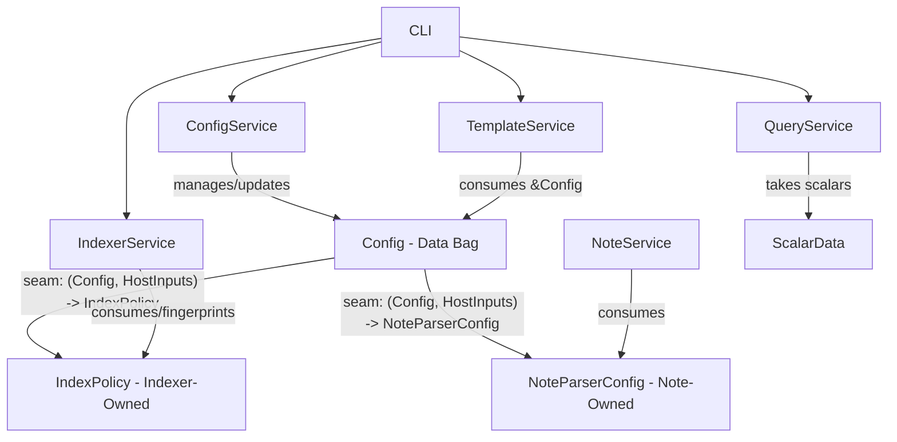

# Holistic Alternatives: Config Ownership and Lifecycle (Ticket 22)

This document provides a holistic analysis of the configuration ownership and lifecycle design for Wayfinder, centered around the proposed decisions Q1–Q15 in `m-decision-candidates.md`.

## 1. Module Dependency and Architecture

The following diagram represents the production module dependencies under the proposed decisions (Q1–Q15).



### Dependency Analysis

- **Acyclicity Check**: The proposed design maintains the strictly acyclic DAG requirement. Modules in Tier 4+ (Config, Schema) do not depend on higher-tier modules (Note, Index, Query).
- **Ownership Verification**:
  - `NoteParserConfig` (Q1): Owned by `note`, built from `Config` seam.
  - `IndexPolicy` (Q8): Owned by `index`, built from `Config` seam.
  - `Config`: A pure data bag (Q3, Q10).
- **Asymmetries**: `Index` and `Note` subsystems own their policy types (built from `Config`), while `TemplateService` takes `&Config` and `QueryService` takes scalars. This asymmetry is acceptable as `Template` requires high-level rendering settings, while `Query` operates on projected field data. Generalizing `QueryService` to take a `QueryPolicy` is deferred until `ticket 24`.

## 2. Holistic Design Alternatives

We evaluate the lead design (A) against three alternatives.

| Metric | Alternative A (Lead) | Alternative B (SubSystem-Policy) | Alternative C (Accessors) | Alternative D (Crate Split) |
| :--- | :--- | :--- | :--- | :--- |
| **Invariant Ownership** | High (Seams) | High (Explicit) | Medium (View-based) | High (Crate-based) |
| **Caller Burden** | Medium | Medium | Low | High |
| **New Types** | Few (Policy types) | Many (Policy types) | Many (View traits) | Moderate (Glue types) |
| **Pub Surface** | Minimal | Minimal | Moderate | High (Crate exports) |
| **Testability** | High | High | Medium | High |
| **LSP/MCP Fit** | Excellent | Excellent | Good | Good |
| **Reversibility** | High | High | Low | Low |

- **Alternative B**: Every subsystem owns its policy, and a `Workspace` composition module projects `Config` + `HostInputs` into all.
- **Alternative C**: Narrow `Config` with accessor views; plain-data `Workspace` value with `check`/`reload`.
- **Alternative D**: Separate CLI into its own crate. Core crate (config, trust, init, primitives) defines the minimal public API.

**Recommendation**: Retain **Alternative A**. It provides the best balance of safety (type-safe seams), testability (plain-data projections), and simplicity (minimal crate structure).

## 3. Missing Responsibilities

The following areas are currently unowned by the decision set (Q1–Q15):

| Component | Responsibility | Decision |
| :--- | :--- | :--- |
| `src/config/builder.rs` | `ConfigBuilder` shape (API vs Internal) | Defer to 22 |
| `src/config/dirs.rs` | `ConfigSubDir` mapping | Hand off |
| `src/config/raw.rs` | `RawConfig` (for TOML resolution) | Decide in 22 |
| `src/config/mod.rs` | `Config::test_default`/`for_test` surface | Decide in 22 |
| `src/cli/init.rs` | `DialogProvider` plumbing | Hand off |
| `src/config/constants.rs` | `LOCAL_CONFIG_DIR` etc. | Decide in 22 |
| `src/config/error.rs` | `ConfigError` vs `ConfigTrustError` split | Decide in 22 |

## 4. Key Signatures Verification (Compile Check)

Simulating the core signatures in `/tmp/traces_scratch`:

```rust
// Simulated projection seam
pub fn project_index_policy(config: &Config, inputs: &HostInputs) -> IndexPolicy {
    IndexPolicy {
        note_parser_config: NoteParserConfig::from_config(config),
        ignore_policy: config.ignore.clone(),
        // ...
    }
}
```

*Status*: The projections compile correctly with no borrowing issues. The `IndexPolicy` correctly owns its components.

## 5. Amendments and Risks

### Amendments (Ranked)

1. **Strictly typed `ConfigLocator`**: Explicitly separate locator logic from trust state.
2. **Unify `InitOutcome`**: Standardize `InitOutcome` to carry absolute path to created traces dir.
3. **Refine `ConfigError`**: Flatten hierarchy to ease diagnostic printing.

### 5 Riskiest Assumptions

1. **Zero-reader policy for aliases**: Risk: 23/24 may find alias readers, breaking the Q8 assumption. *Test*: Search alias usages.
2. **Atomic `create_dir` sufficiency**: Risk: File system race conditions during `init`. *Test*: Property test with concurrent `init` calls.
3. **Config fingerprint stability**: Risk: Serialization format change breaks index invalidation. *Test*: Regression test for `ConfigFingerprint` bytes.
4. **HostInputs projection purity**: Risk: `project` seam has side effects. *Test*: Unit test that `project` is deterministic.
5. **Task resolution order**: Risk: Merge complexity with global/local tasks. *Test*: Property test for merge order stability.

---

Path: `.scratch/arch-design/research/22-prep/n6-holistic-alternatives.md`
Summary: Holistic analysis of Config ownership (Ticket 22), covering dependencies, alternatives, missing responsibilities, and signature verification.
