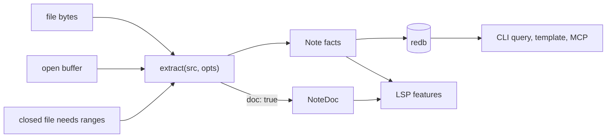

# Note shapes: lessons from Markdown tools and a stress test of designs

**Superseded in part.** The ticket's `## Answer` is the final decision. Section 5
of this file proposed one event loop with an optional document hook. The review
in `h5-round2-review.md` replaced that hook with a separate scan,
`NoteDoc::scan`. Read sections 1 to 4 for the lessons. Ignore the pipeline
diagram and `opts.doc` in section 5.

This file supports the grilling of ticket 23. Each proposal is tagged [P]. Each
fact is tagged [V] and cites a digest line. Each inference is tagged [H].

Four scouts read the digests. Their files are in
`.design/2026-10-26-model-note-facts-doc/scouts/` (`p1` to `p4`). The `.design`
directory is not in Git. This file keeps the findings that matter.

## 1. What the projects show

- [V] Every language server splits its data into two parts. One part holds
  cross-file facts. The other part holds the document of an open buffer. The
  buffer wins over the disk file while it is open (IWE
  `iwe-org-iwe-src-digest.txt:39336-39367`; rumdl
  `lsp_rvben-rumdl-src-digest.txt:36977-36983`; Marksman
  `lsp_artempyanykh-marksman-digest.txt:11638-11674`; Markdown Oxide
  `lsp_feel-ix-343-markdown-oxide-src-digest.txt:2193-2214`).
- [V] No project persists source positions. Marksman, IWE and Markdown Oxide
  rebuild all positions in memory at each start-up and keep no disk cache. rumdl
  writes a disk cache in CLI mode. Its language server does not read that cache
  at start-up (`lsp_rvben-rumdl-src-digest.txt:36958-37012`).
- [V] The projects that persist data keep facts. zk keeps a SQLite index
  (`zk-src-digest.txt:8248-8285`). Dataview keeps page metadata in IndexedDB
  (`obsidian_blacksmithgu-obsidian-dataview-src-digest.txt:3771-3809`).
  obsidian.nvim keeps paths, aliases and file times in JSON
  (`vim_obsidian-nvim-digest.txt:619-642`).
- [V] Dataview stores a line and a source position for each list item inside its
  page data
  (`obsidian_blacksmithgu-obsidian-dataview-src-digest.txt:5014-5054`). It still
  reads the file again before a task edit (`…:13714-13728`).
- [H] The earlier report `h1` said that these tools "support" stored spans. That
  was too strong. They support positions in memory. None supports positions on
  disk.

## 2. Responsibilities and the data each one needs

| Use case | Data it needs | When it runs | Where the projects get it |
|---|---|---|---|
| Query, list, table | Typed fields, tags, headings, items, tasks, link edges | Per query, over many notes | Persisted facts (zk, Dataview, Tasks) |
| Template render | Frontmatter, tags, path, dates. Sometimes raw text. | Per render | Facts. A raw-content call reads the file (Templater `…src-digest.txt:2597-2607`). |
| Task query | Status, dates, line, section or heading | Per query | Facts with a line and section (Tasks `…src-digest.txt:26129-26170`) |
| Backlinks as a query | Resolved link edges | Per query | Facts (zk `links` table) |
| Completion (links, tags, headings) | Cursor line, candidate names | Per request, often | Buffer text plus the name index (zk, Marksman, rumdl) |
| Hover, go to definition | Link under cursor, resolved target, target preview | Per request | Buffer range plus facts |
| References, backlinks panel | Every link occurrence to a target, with a range | Per request | In-memory ranges of all files (Marksman, IWE, Oxide). zk has none and falls back to text search (`zk-src-digest.txt:4625-4661`). |
| Rename | Exact edit span of every occurrence, current target rules | Per request | Fresh bytes. Tasks and mdnotes show the failures of stale lines (`…:10684-10714`; `vim_ymich9963-mdnotes-nvim-digest.txt:4702-4737`). |
| Diagnostics | Source spans of dead links, bad fields, bad sections | Per edit, after a delay | Fresh buffer parse plus target facts (zk 1 s, Oxide 300 ms, Marksman 200 ms) |
| Symbols, folding | Heading line, text range, section extent | Per request | Heading facts (rumdl workspace symbols use heading line) or fresh parse |
| Schema check with spans (ticket 20) | Key span and element span of frontmatter | On open buffer and on check | Fresh bytes. No tool stores them. |
| Body-section check (ticket 36) | Heading levels, section extent, text slices | On check | Heading lines give the extent. Text slices need the source. |
| Footnote and callout features | Definition and reference ranges, callout kind and title | Per request | Fresh parse only. IWE and Marksman drop both. rumdl records footnote offsets. |
| Export and rewrite | Event stream, no spans | Batch | Transient events (obsidian-export). Not persisted. |
| MCP or agent read | Facts, section text | Per call | Facts plus file read (IWE shares one graph with its MCP host) |
| Format and lint | Exact spans, round trip | Per save | Original text (Linter, rumdl) |

## 3. Lessons

- **L1. Edits never use stored positions.** [V] Tasks re-reads the file and
  searches again. It admits that an identical new line can fool the search
  (`obsidian_obsidian-tasks-src-digest.txt:10591-10714`). Fileclass once lost
  values through stale metadata
  (`obsidian_mdelobelle-fileclass-src-digest.txt:1745-1756`). mdnotes rewrites
  links by regex and can change the wrong text. [P] Stored spans never drive an
  edit. They can at most guide a display.
- **L2. One extractor prevents drift.** [V] rumdl built one shared index builder
  because the CLI and the language server disagreed on slugs, duplicate anchors
  and disable comments (`lsp_rvben-rumdl-src-digest.txt:36897-36907`). zk uses
  two link parsers with different options. Its references are weak
  (`zk-src-digest.txt:6247-6305,3404-3466,4625-4661`). Markdown Oxide repeats
  link syntax rules in its rename code and marks them as misplaced
  (`lsp_feel-ix-343-markdown-oxide-src-digest.txt:2753-2758`). [P] Facts and
  document must come from one set of rules.
- **L3. The document is a flat set of ranges, not a tree.** [V] The VS Code
  language service has no universal note type. Each provider keeps its own lazy
  view per document version
  (`lsp_microsoft-vscode-markdown-languageservice-digest.txt:2366-2388,2684-2747`).
  A heading there has three ranges: the full line, the text and the section
  extent (`…:2017-2058`). A link has five: full, target, URL, fragment and title
  (`…:3882-3918`). rumdl keeps line facts and byte ranges and no tree
  (`lsp_rvben-rumdl-src-digest.txt:33386-33415`). Only Marksman keeps a full
  concrete tree for every file
  (`lsp_artempyanykh-marksman-digest.txt:6859-6866`).
- [V] Marksman reparses the whole text on each change (`…:6928-6952`). IWE also
  parses the whole new text (`iwe-org-iwe-src-digest.txt:54064-54073`). No tool
  parses incrementally.
- **L4. Facts hold several row sizes.** [V] zk has a minimal note (ID, path,
  title, metadata) and a full note with body and raw text. Queries choose the
  size (`zk-src-digest.txt:16549-16594,9384-9393`). [P] Heavy text stays
  separate from the common fact row. Ticket 24 owns that decision.
- **L5. Link classes differ by tool.** [V] zk has implicit, Markdown and wiki
  types plus an external flag. It has no embed, anchor or block class
  (`zk-src-digest.txt:16148-16195`). obsidian.nvim names wiki and Markdown
  styles, anchor targets and block targets
  (`vim_obsidian-nvim-digest.txt:1195-1207`). obsidian-export keeps file,
  section and label, and marks embeds
  (`rust_zoni-obsidian-export-digest.txt:3373-3404`). [H] The facts need syntax,
  embed flag, path, heading anchor and block id. External URLs are a different
  class with a different consumer.
- **L6. Frontmatter positions are a gap everywhere.** [V] Markdown Oxide drops
  the value positions of tags
  (`lsp_feel-ix-343-markdown-oxide-src-digest.txt:5750-5800`). Advanced Metadata
  Cache has frontmatter links without offsets and uses a fallback range
  (`obsidian_mnaoumov-obsidian-advanced-metadata-cache-src-digest.txt:11050-11081`).
  Metadata Menu rewrites the whole frontmatter on a field change
  (`obsidian_mdelobelle-metadatamenu-src-digest.txt:20019-20039`). [H] An
  on-demand scan of the bytes in hand is the usual answer.
- **L7. Debounce, version and Unicode belong to the host.** [V] Markdown Oxide
  once wedged on per-key diagnostics (`…:1659-1668`). Marksman sends diagnostics
  without a version (`lsp_artempyanykh-marksman-digest.txt:11236-11254`). zk
  counts runes, not UTF-16 units (`zk-src-digest.txt:3365-3390`). VS Code marks
  temporary documents with version -1 (`…digest.txt:684-685`). [P] The document
  carries byte spans and a line index. The host adds the version and the UTF-16
  conversion. Test non-BMP characters.
- **L8. One rich shared core can serve all hosts.** [V] IWE serves its LSP, MCP
  and CLI from one graph. The graph holds an arena, line ranges, full text and
  frontmatter (`iwe-org-iwe-src-digest.txt:53590-53605`). The LSP follows the
  buffer. The MCP watcher follows the disk (`…:39336-39367,33941-33958`). [H]
  This is the best case for a shared model. Its costs are full text in every
  host and an unstated policy difference between hosts.
- **L9. Footnotes and callouts are editor-only.** [V] IWE and Marksman do not
  model them. rumdl records footnote offsets for lint rules
  (`lsp_rvben-rumdl-src-digest.txt:30343-30353`). Markdown Oxide reads footnote
  targets and scans the line for callout syntax
  (`lsp_feel-ix-343-markdown-oxide-src-digest.txt:3742-3762,3494-3499`). [P]
  Keep them out of the facts.
- **L10. Task facts carry a place.** [V] A Tasks `Task` stores a line, a section
  start and the preceding heading (`…src-digest.txt:26129-26170`). [H] Check if
  our `ListItem` needs a heading context for queries.

## 4. Candidate designs

| Id | Design | Persisted | Positions come from |
|---|---|---|---|
| D0 | Keep: one span-free `Note` | `Note` | Nowhere |
| D1 | One `Note` with stored spans | `Note` plus spans | The stored row |
| D2 | `Note` plus a `SpanTable` sidecar | `Note` | A parse of bytes in hand |
| D3 | `Note` (facts) plus a core `NoteDoc`. One extractor feeds both builders. | `Note` | A parse of bytes in hand |
| D4 | `Note` plus an extractor. The LSP host builds its own document. | `Note` | The host, from the extractor |
| D5 | D3 plus stored link occurrence positions in the facts | `Note` plus link spans | The stored row for links only |
| D6 | Lossless tree for every file | The tree | The tree |

Pipeline of D3. The facts path and the document path share one event loop.

### Stress scenarios

Each cell says how the design behaves. "ok" means no problem found.

| Scenario | D1 | D2 / D3 | D4 | D5 | D6 |
|---|---|---|---|---|---|
| Cold CLI query | Reads +4.3% bytes | ok (the doc is off) | ok | Reads link spans | Slow, +59% parse |
| LSP start at 50,000 notes | Decode, about 0.3 s [H] | Background parse, about 2.1 s on 12 threads [H]. Facts serve the first requests. | Same as D3 | Decode | Decode, big |
| References to a hub note | Row decode | Parse of each backlink file. Slow for 1,000 files. | Same | Row decode | Row decode |
| Rename across files | Must reparse anyway | Fresh bytes, correct | Correct | Must reparse anyway | Must reparse anyway |
| Diagnostics per keystroke | ok | ok | ok | ok | ok |
| Schema key spans (ticket 20) | Needs a scan anyway | ok, in the doc | Host builds them | Needs a scan anyway | ok |
| Body check from the CLI (ticket 36) | Extent from lines | Extent from heading lines. Text from a file read. | Needs the host | Same as D1 | ok |
| Agent edits a file, then a query | Row stale until refresh | ok | ok | Row stale for positions | Row stale |
| Format upgrade | Rewrites all rows | Rewrites all rows | Rewrites all rows | Rewrites all rows | Rewrites all rows |
| Drift between rules | One builder | One extractor | Two consumers of the extractor | One builder | One builder |
| Number of types | 1 | 2 | 1 in core | 1 | 1 plus a tree |
| Stale span can reach an edit | Possible | Not possible | Not possible | Possible for links | Possible |

[H] D1 and D5 have the faster closed-file requests. D2, D3 and D4 have no stale
span class. No precedent has D1 or D5 on disk.

### Measurements taken in this session

- [V, probe on this repository's 2,716 Markdown files] A pass 1 that collects
  404,753 occurrences (headings, links, footnotes, code, quotes, items) takes
  123.5 ms. The same pass without collection takes 121.8 ms. The extra cost is
  1.4% of pass 1 and about 0.3% of a full parse. The probe stores only a kind
  and two offsets. A real builder also builds link parts, so the real cost is
  higher.
- [V] The full parse takes 588.4 ms on one thread and 116.0 ms on 12 threads.
  This is a 5.1 times gain. A linear extrapolation gives about 2.1 s for 50,000
  notes [H].
- [V] 72.9% of 32,079 outlinks in the corpus are external URLs. The corpus is
  documentation, so a vault has fewer.

## 5. Recommendation

[P] Choose D3, with these limits.

1. `Note` stays the facts type. It keeps the lines it has today. It stores no
   byte span and no footnote or callout.
2. One extractor feeds both shapes. A single event loop calls shared rules for
   slugs, link classes, tag grammar and field lexing. The document builder is an
   optional hook, with no generic and no trait.
3. `NoteDoc` is a flat set of ranges plus a line index. It has no tree. It
   holds:
   - frontmatter key and element spans;
   - heading ranges and section extents;
   - link occurrence parts;
   - tag and field occurrences;
   - item and checkbox spans;
   - footnotes, callouts, code ranges and block ids.

   The host adds cursor lookup, the version and the UTF-16 conversion.
4. The index persists `Note` only. The LSP host starts from the facts and builds
   the document index in the background, in parallel, from the files. An open
   buffer overrides the disk. A closed-file edit reads the current bytes.
5. Link facts get classes. Internal links carry syntax, embed flag, path,
   heading anchor and block id. External URLs are stored only if a consumer
   exists. Ticket 28 decides that.
6. Ticket 36 reads section extents from heading lines. It reads text slices from
   the source.

[H] Why not D1 or D5: no precedent persists positions, and every edit path
re-reads the file. The only gain is faster closed-file requests. A background
parse removes most of that cost.

[H] Why not D4: tickets 20 and 36 need spans outside the LSP. A core document
keeps those spans testable now. The editor-specific indexes stay in the host.

[H] Why not D6: the cost is +59% parse time. No precedent needs it.

### What would change the recommendation

- A measured LSP start-up that is too slow at the vault sizes of ticket 17. Then
  store compact link occurrence positions (D5) and add a freshness check.
- A document build that costs more than a few percent of a cold parse. Then turn
  the hook off at compile time.
- A consumer that needs the document in the index path.
- Ticket 28 shows that templates read external links. Then store them.

### Risks of D3

- The facts and the document can disagree. [P] Add a differential test on the
  corpus: count each construct in both outputs.
- A host must handle the buffer overlay and the version. [H] Ticket 34 owns
  this.
- The first LSP requests that need ranges can wait for the background parse. [P]
  Answer from facts first. Parse the open file at once.
- Heading identity differs between facts and document if the slug rule differs.
  [P] The slug rule lives in one function.

## 6. Corrections to earlier statements

- The `h1` verdicts "supports Q1" for stored spans were too strong (section 1).
- The 35 times start-up gain compared a single thread with decoding. With 12
  threads the gap is about 7 times, and it comes from a one-time background job
  [H].
- The design "project the `Note` from a `NoteDocument`" (S4 in the guide) is
  replaced by one extractor with two builders. It avoids building the document
  on the cold path.

## 7. Not checked

- Real cost of a full document builder with link parts and strings.
- Memory of a host that holds the document of 50,000 notes.
- Block references (`^id`) in the current `LinkTarget`.
- Whether any query or template reads outlinks (ticket 28).
- Behaviour of these designs on a personal vault. The probe corpus is
  documentation.
- Source repositories beyond the digests.
